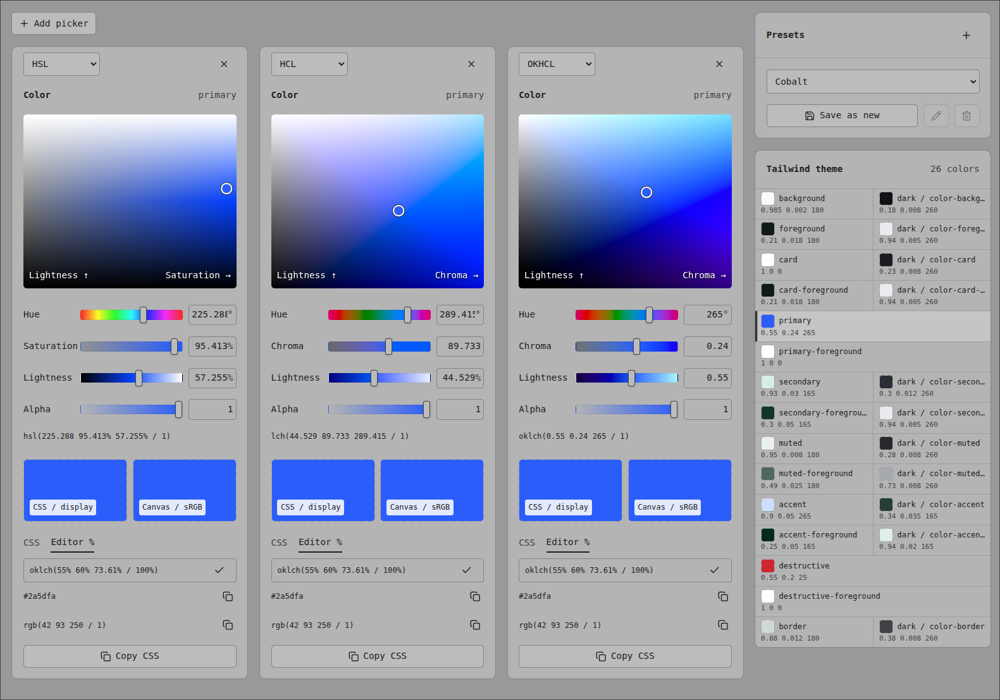

# OKLCH kinda sucks

An OKLCH picker and Tailwind theme editor that uses the current browser to render colors.



Open [color.domi.ninja](https://color.domi.ninja), select a theme color, and adjust it with any picker. Add more pickers to compare color spaces. Light and dark previews update together. Copy the URL to share the color. Use Share to create a link to the current workspace.

## Run locally

Use Node 24+ and pnpm.

```sh
pnpm install
pnpm dev
```

Open the local URL printed by Vite. Pick a theme color, adjust the plane or sliders, and see the component preview update. Save a preset to keep it in this browser. Export CSS for the compiled stylesheet or export the app for a ZIP you can open offline.

Use Add picker to open synchronized RGB, HSL, HCL, or OKHCL panels. Each panel has its own mode selector and close button. Its three planes show every pair of color channels, with the remaining channel held at its current value. HCL uses CIELCH D50; OKHCL uses OKLCH. RGB and HSL controls use the browser's sRGB result.

The normal URL contains the current color and open picker modes. Theme edits, selected token, presets, preview width, and tab stay in browser storage and survive reloads. Share saves a snapshot of the current workspace and active preset, then creates a link you can open in another browser. It does not include other saved presets. Shared workspaces become local copies when opened. Existing workspace URLs still import their saved state. Built-in themes are protected. Use Save as new to keep an edited copy. The Brutalist theme uses square corners, hard shadows, and bright colors.

Light and dark previews appear together, one above the other.

The ZIP contains standalone `index.html` and `dark.html` demos, compiled `styles.css`, editable `theme.css`, and a rebuildable demo in `src/index.html`. Run `npm install && npm run build` in the extracted folder to rebuild the CSS after editing the theme.

## Color formats

Each picker has a matching color editor with Editor % below it. RGB uses hex; the other pickers use their CSS color syntax. Channel controls show native values and percentages together. Percentages use the slider ranges: RGB 100% means 255, CIELCH chroma 100% means 150, and OKLCH chroma 100% means 0.4. Hue 100% means 360 degrees. Percentage hue is editor notation. The CSS editors use degrees for hue.

Display color shows the native CSS color. sRGB preview shows an 8-bit sRGB canvas readback. Hover or focus either swatch for details. Wide-gamut displays may show a difference. RGB values and gamut mapping depend on the browser. Transparent pixels are quantized and may lose RGB precision during canvas readback.

## Development

React 19, TypeScript, Vite 8, Tailwind 4, and a shadcn-style Button built with Radix Slot and CVA. The editor styles compile through the Vite plugin. Picker planes render in separate workers. The Node server serves the built app and handles share links using SQLite. Ordinary edits stay in browser storage; only Share writes a snapshot to the database. The development command starts Vite on port 5173 and the API on port 5174. Set `SHARE_DB_PATH` to choose the database file. The local default is `.data/shares.sqlite`. The demo styles compile separately in a Web Worker with Tailwind's compiler and render in a sandboxed iframe.

Theme CSS accepts Tailwind's CSS configuration, including `@theme` and custom rules. Local Tailwind imports are bundled; arbitrary remote imports and JavaScript plugins are not supported. Every literal `oklch(...)` in the editable stylesheet appears in the color list. Expressions outside the slider ranges can be edited in Theme CSS.

```sh
pnpm build
node --test scripts/server.test.mjs
pnpm exec playwright install chromium firefox webkit
pnpm test
```

Tests cover browser canvas output, alpha, out-of-gamut colors, keyboard sliders, mobile overflow, live compilation, browser presets, and offline exports in Chromium, Firefox, and WebKit.

## Deploy

`pp plan` validates `deploy.yml`. `pp deploy` builds the app and Node server into a container and deploys it to color.domi.ninja. The `shares` volume keeps `/data/shares.sqlite` across deployments. Removing that volume deletes saved share links. Deployment state stays in the ignored `.deploy/` directory.
